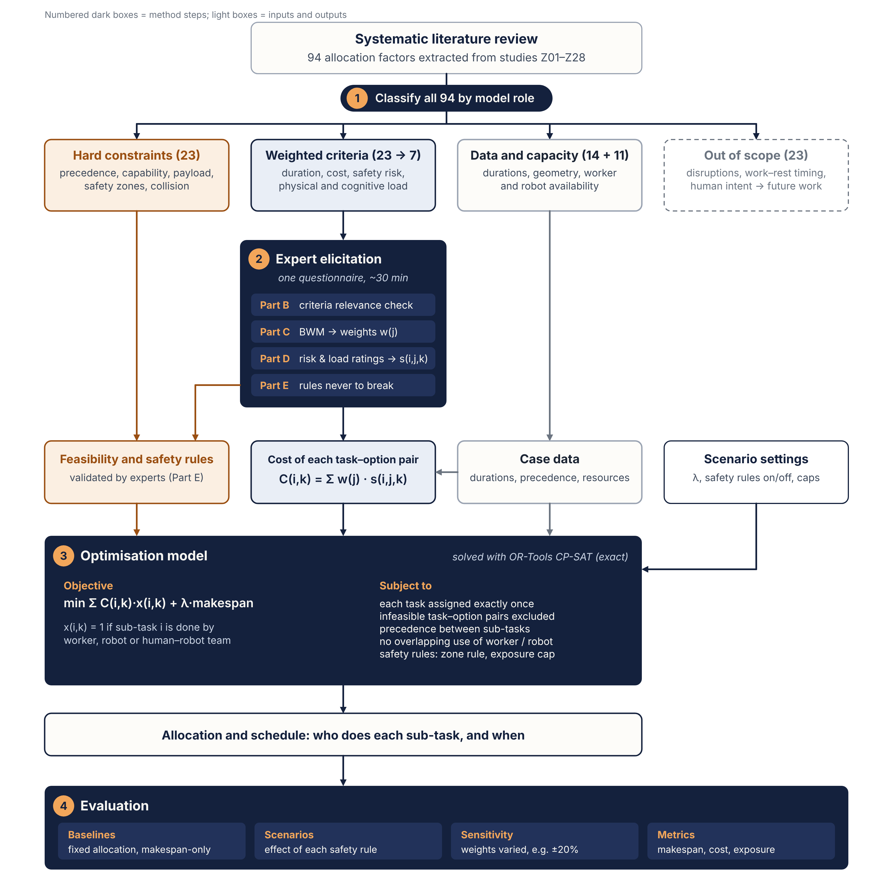

# Safety-aware Human–Robot Task Allocation (WP5)

A decision-support tool that decides **who does each construction task — a worker (W), a robot (R) or a human–robot team (HR) — and when**, so the plan is cheap, fast and safe.

- **Expert input (once):** criterion weights from a Best–Worst Method (BWM) questionnaire, hard rules and a 1–5 scoring rubric for seven criteria C1–C7.
- **Project input (each project):** an Excel workbook listing tasks, precedence and, for each task, the execution options with durations, worker exposure and rubric ratings.
- **Solver:** Google OR-Tools **CP-SAT**, with an exhaustive search (≤ 7 tasks) and a HiGHS MILP as fallbacks and cross-checks.
- **Output:** the best plan as a Gantt-style timeline in the browser, plus an Excel result file with a Results sheet and a 5-minute Timeline sheet.



**Live demo (built-in example only):** `https://<your-username>.github.io/<repo-name>/`
The online page runs the 3-task example with an in-browser solver. Loading your own Excel and solving with CP-SAT needs the local server (see below).

---

## Model

$$\min \sum_{i,k} C_{ik}\,x_{ik} + \lambda \cdot \text{makespan}, \qquad C_{ik} = \sum_{j=1}^{7} w_j\, s_{ijk}$$

subject to

1. each task gets exactly one option (W, R or HR);
2. infeasible options are excluded (no row in the Options sheet = not allowed);
3. precedence between tasks;
4. each worker and each robot does one task at a time (HR uses one of each);
5. optional safety rules: the **zone rule** (a worker alone and a robot alone never work at the same time) and a **cap** on total worker exposure in the hazard zone.

Scores: C1 = min(1, duration / reference duration), C2 = min(1, cost / reference cost), C3–C7 = (rubric rating − 1) / 4. The references are fixed in Settings, so expert weights stay valid across projects.

---

## Installation

You need **Python 3.10 or newer**. Use a fresh virtual environment. On macOS this avoids the `protobuf "File already exists in database"` crash that can happen when ortools shares an environment with other packages.

**macOS / Linux**

```bash
git clone https://github.com/<your-username>/<repo-name>.git
cd <repo-name>
python3 -m venv ortools-env
source ortools-env/bin/activate
pip install -r requirements.txt
```

**Windows (PowerShell)**

```powershell
git clone https://github.com/<your-username>/<repo-name>.git
cd <repo-name>
py -m venv ortools-env
ortools-env\Scripts\Activate.ps1
pip install -r requirements.txt
```

Check that the install worked:

```bash
python -c "import ortools, openpyxl, scipy; print('ortools', ortools.__version__)"
```

| Package | Used for | Required? |
|---|---|---|
| `ortools` | CP-SAT solver | Recommended. Without it, only projects of up to 7 tasks, or small MILP cases, can be solved |
| `openpyxl` | reading and writing the Excel workbooks | Yes |
| `scipy` | HiGHS MILP fallback and cross-check | Optional |

Activate the environment each time you open a new terminal (`source ortools-env/bin/activate`).

---

## Usage

### 1. Web app (recommended)

```bash
python app.py
```

Your browser opens **http://localhost:8000**. Then:

1. **Load project Excel…**: choose `project_template.xlsx` or your own workbook.
2. Change the **Workers**, **Robots** and **Panels**, the λ slider, the zone rule or the exposure cap. The plan is re-solved each time.
3. **Scenarios A–D** compare the rule sets: A cost only · B + makespan · C + zone rule · D + exposure cap.
4. **Download result Excel** saves the current plan.
5. **Back to example** returns to the built-in 3-task example.

Stop the server with `Ctrl+C`.

### 2. Command line

```bash
python allocate.py project_template.xlsx                      # writes project_template_result.xlsx
python allocate.py my_project.xlsx --out my_result.xlsx
python allocate.py project_template.xlsx --workers 3 --robots 2 --panels 3
python allocate.py project_template.xlsx --zone yes --cap 120 --lam 0.05
```

### 3. Independent check (MILP)

```bash
python verify_milp.py project_template.xlsx --panels 2
```

This solves the same model as a time-indexed MILP with HiGHS. It should give the same objective as CP-SAT.

---

## The project workbook

Start from `project_template.xlsx`, a façade-panel installation at Level 2 with 2 workers and 1 robot. Every sheet has a header row and notes.

| Sheet | Who fills it | Content |
|---|---|---|
| README | – | how to fill in the workbook |
| Settings | project team | workers, robots, cost rates (W / R / HR per minute), reference duration and cost, λ, zone rule, exposure cap, time limit, panels |
| Weights | experts (BWM, once) | w1–w7 for C1–C7; normalised automatically |
| Scoring rubric | experts (once) | 1 / 3 / 5 anchors for C3–C7 |
| Tasks | project team | Task ID, name, predecessors, **Per panel**, **After previous panel**, type, zone |
| Options | project team | one row per feasible task–option pair: duration, worker exposure, ratings C3–C7 |
| Assumptions | project team | where the numbers come from |

**Repeated work (panels).** Mark a task `Per panel = Yes` and it is repeated for every panel (P1A, P1B, …). `After previous panel` links a task to the previous panel's copy, for example "lift panel B only after panel A is fixed" when there is one crane. Set the default number of panels in Settings › Panels, then change it in the web app or with `--panels`.

`worked_example.xlsx` is the 3-task example from the slides (1 worker, 1 robot). To rebuild both templates, run `python make_templates.py`.

---

## Solvers and limits

| Solver | When it is used | Notes |
|---|---|---|
| OR-Tools CP-SAT | whenever `ortools` is installed | proves optimality; recommended for 3 or more panels (18+ sub-tasks) |
| Exhaustive search | no ortools, ≤ 7 tasks | exact; also used in the browser |
| HiGHS MILP | no ortools, > 7 tasks | exact but slow: 2 panels (12 tasks) take about 15 s, and 3 panels may hit the time limit without proof |

Reference results for `project_template.xlsx` (2 workers, 1 robot, zone rule on, λ = 0.02):

- **2 panels:** makespan 260 min, cost 4.372, worker exposure 175 min.

---

## Repository layout

```
├── index.html               web interface (also the GitHub Pages page)
├── app.py                   local web server; calls allocate.py
├── allocate.py              model, CP-SAT, exhaustive search, Excel input/output
├── verify_milp.py           independent time-indexed MILP (HiGHS)
├── make_templates.py        builds the two template workbooks
├── project_template.xlsx    realistic project template
├── worked_example.xlsx      3-task example from the slides
├── examples/
│   └── hr_task_allocation_cpsat.py   minimal stand-alone CP-SAT example
├── docs/method_framework.png
└── requirements.txt
```

---

## Publishing the demo with GitHub Pages

Repository **Settings → Pages → Build and deployment → Deploy from a branch → `main` / `(root)` → Save**. After about a minute the page appears at `https://<your-username>.github.io/<repo-name>/`. GitHub Pages only serves static files, so the online page runs the built-in example. Excel upload and CP-SAT need `python app.py` on your own computer.

---

## 中文快速说明

1. 安装 Python 3.10 及以上版本。
2. 在项目文件夹里依次运行：
   ```bash
   python3 -m venv ortools-env
   source ortools-env/bin/activate
   pip install -r requirements.txt
   ```
   Windows 上激活环境用 `ortools-env\Scripts\Activate.ps1`。
3. 运行 `python app.py`，浏览器会打开 http://localhost:8000。点 **Load project Excel…** 上传 `project_template.xlsx`，然后可以调整工人、机器人和面板数量，结果可以下载成 Excel。
4. 每次新开终端都要先激活环境，再运行 `python app.py`，这样才会用 CP-SAT 求解。
5. GitHub Pages 上的网页只能跑内置的示例。上传自己的 Excel 和用 CP-SAT 求解，需要在本地运行。

---

## References

- Rezaei, J. (2015). Best-worst multi-criteria decision-making method. *Omega*, 53, 49–57.
- Rezaei, J. (2016). Best-worst multi-criteria decision-making method: Some properties and a linear model. *Omega*, 64, 126–130.
- Perron, L., & Didier, F. CP-SAT. Google OR-Tools. https://developers.google.com/optimization
- Huangfu, Q., & Hall, J. A. J. (2018). Parallelizing the dual revised simplex method. *Mathematical Programming Computation*, 10, 119–142. (HiGHS)
